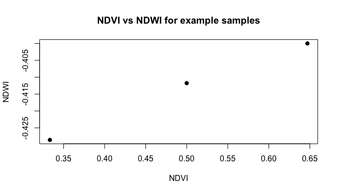

<!-- README.md is generated from README.Rmd. Please edit that file -->

# RRWjun

<!-- badges: start -->

<!-- badges: end -->

This package is for practicing how to creat R
packages([Reproducible-Research-WorkflowPublic](https://github.com/paezha/Reproducible-Research-Workflow)).
The goal of RRWjun is to provide functions to calculate commonly used
remote sensing indices from spectral band values.

**NDVI** (Normalized Difference Vegetation Index)

$$
\mathrm{NDVI} = \frac{NIR - Red}{NIR + Red}
$$

**EVI** (Enhanced Vegetation Index)

$$
\mathrm{EVI} = 2.5 \times \frac{NIR - Red}{NIR + 6 \times Red - 7.5 \times Blue + 1}
$$

**NDWI** (Normalized Difference Water Index)

$$
\mathrm{NDWI} = \frac{Green - NIR}{Green + NIR}
$$

## Installation

Install the development version from GitHub:

``` r
# install.packages("remotes")
remotes::install_github("Tangent21/RRWjun")
```

## Functions

| Function | Description                              |
|----------|------------------------------------------|
| `ndvi()` | Compute NDVI from NIR and red bands      |
| `evi()`  | Compute EVI from NIR, red and blue bands |
| `ndwi()` | Compute NDWI from green and NIR bands    |

## Example data

The package includes `spectral_example`, a data set of 10 samples. Each
row is one sample and each column is a band (reflectance, 0-1).

``` r
library(RRWjun)

data(spectral_example)
head(spectral_example)
#>   Sample_ID Blue Green  Red NIR
#> 1         1 0.10  0.25 0.20 0.6
#> 2         2 0.08  0.30 0.15 0.7
#> 3         3 0.12  0.20 0.25 0.5
```

``` r
ndvi(spectral_example$NIR, spectral_example$Red)
#> [1] 0.5000000 0.6470588 0.3333333
evi(spectral_example$NIR, spectral_example$Red, spectral_example$Blue)
#> [1] 0.4878049 0.6875000 0.2976190
ndwi(spectral_example$Green, spectral_example$NIR)
#> [1] -0.4117647 -0.4000000 -0.4285714
```

Add the results as new columns:

``` r
spectral_example$ndvi <- ndvi(spectral_example$NIR, spectral_example$Red)
spectral_example$ndwi <- ndwi(spectral_example$Green, spectral_example$NIR)
head(spectral_example)
#>   Sample_ID Blue Green  Red NIR      ndvi       ndwi
#> 1         1 0.10  0.25 0.20 0.6 0.5000000 -0.4117647
#> 2         2 0.08  0.30 0.15 0.7 0.6470588 -0.4000000
#> 3         3 0.12  0.20 0.25 0.5 0.3333333 -0.4285714
```

## Read your own Excel file

Your file should have one row per sample and one column per band:

``` r
df <- read_spectral_data("my_samples.xlsx")
df$ndvi <- ndvi(df$NIR, df$Red)
```

## Plot

``` r
plot(spectral_example$ndvi, spectral_example$ndwi,
     xlab = "NDVI", ylab = "NDWI", pch = 19,
     main = "NDVI vs NDWI for example samples")
```


